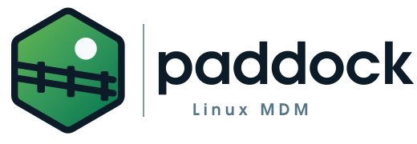
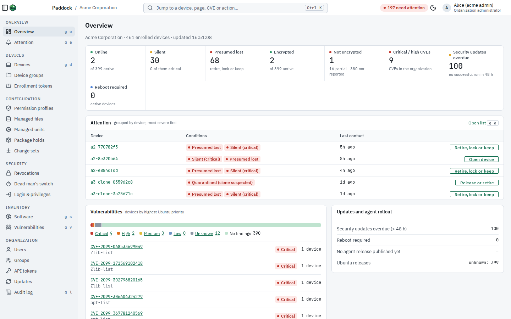
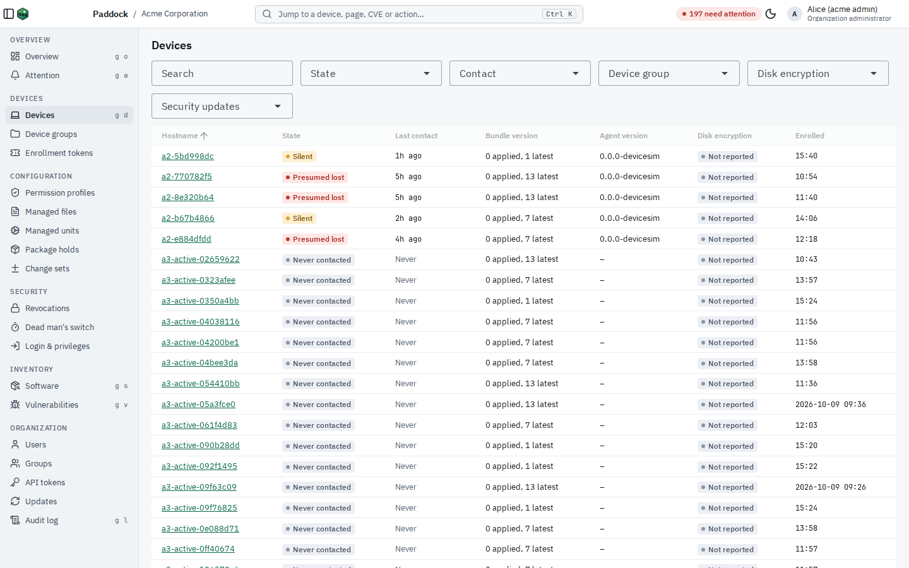
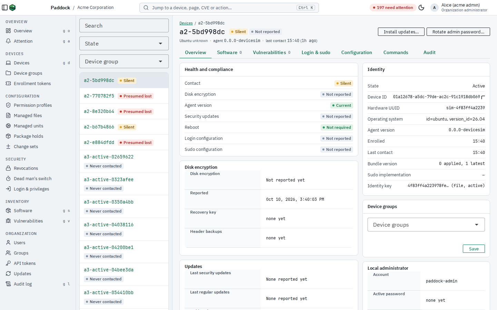
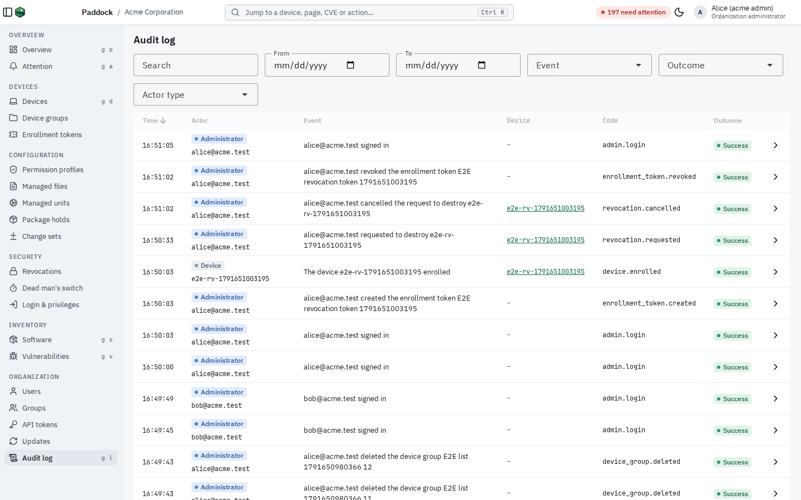

<p align="center">
  <picture>
    <source media="(prefers-color-scheme: dark)" srcset="docs/assets/logo/paddock-horizontal-dark.svg">
    
  </picture>
</p>

# Paddock

Open-source management for Linux workstations that keeps local administrator rights with their users.

Paddock distributes signed configuration to Linux laptops and desktops, manages identity and device login
(Authentik and Himmelblau), sudo rights from permission profiles, a managed local administrator, disk encryption
with TPM2, boot PIN and escrowed recovery keys (also encrypting installed devices in place), updates and inventory (Fleet), and the device lifecycle up to
removing Paddock from a device; it detects tampering and keeps a tamper-evident audit trail for ISO 27001 (WORM storage, signed daily hash chain, verified
every night, exported as signed evidence packages that verify offline). Security events reach signed webhooks, e-mail
and a SIEM feed, and findings record how each one was handled. Retention and privacy settings per organization keep
personal data only as long as the retention schedule says. Signed agent releases are imported from GitHub with one
button and rolled out in waves. Configuration changes are safe to make: each device reports what it applied, every
change can be reverted, changes can reach the fleet in waves that halt on failures, and existing laptops are adopted
in a report-only phase first. A software catalog installs, pins, holds, removes or forbids applications from trusted
APT sources with verified signing keys. Backups are encrypted with a key the administrator confirms, mirrored to local,
SMB, NFS or S3 targets and restored with one command; a release upgrades from the one before it with one command and
rolls back the same way. Administrators collect a diagnostics bundle from a device, review who held which role, and
stream audit events to syslog receivers. Administrators can let an AI assistant work with Paddock through the MCP, within
policies they set. Devices only ever talk to the
server on their own initiative, and keep working when it is unreachable. Users keep the administrator rights their
organization grants them; Paddock makes those rights explicit, reviewable and audited. The portal speaks English
and German, signs administrators in with a passkey, guides a new installation with a setup checklist, and one
identity can switch between the platform administrator role and its organization's role.

<p align="center">
  <picture>
    <source media="(prefers-color-scheme: dark)" srcset="docs/assets/screenshots/overview-dark.png">
    
  </picture>
</p>

<p align="center">
  <picture>
    <source media="(prefers-color-scheme: dark)" srcset="docs/assets/screenshots/devices-dark.png">
    
  </picture>
</p>

<p align="center">
  <picture>
    <source media="(prefers-color-scheme: dark)" srcset="docs/assets/screenshots/device-dark.png">
    
  </picture>
</p>

<p align="center">
  <picture>
    <source media="(prefers-color-scheme: dark)" srcset="docs/assets/screenshots/audit-dark.png">
    
  </picture>
</p>

> [!WARNING]
> **Alpha.** Paddock 0.1.0-alpha.9 is the current pre-release (milestones M0–M8a, the M8s hardening, the lab fixes
> M8x and M8f, the device lifecycle M8d, the device name M8h, the optional automatic unseal M8u, the in-place
> encryption of installed devices M8e, the evidence integrity M8b, the notifications and findings M9, evidence
> exports, privacy and retention M10, safe configuration changes M11, the operator toolbox M12, the software catalog
> M13a, AI assistants through the MCP M14, backup and recovery M15 and the upgrade path M16), meant for evaluation, not
> for production fleets. From 0.1.0-alpha.8 on, every release upgrades from the one before it with `./paddock upgrade`
> and rolls back with `./paddock rollback` (ADR 0047); 0.1.0-alpha.9 is the first such step. 0.1.0-alpha.7 upgrades to
> 0.1.0-alpha.8 first, and 0.1.0-alpha.6 and earlier are installed fresh (`docs/operations/upgrade.md`). Revocation (Lock,
> Destroy, dead man's switch) stays disabled behind `PADDOCK_REVOCATION_ENABLED` until its code has passed the
> second-person review and an installation has passed its hardware acceptance (`docs/operations/revocation-acceptance.md`).

| Read | For |
| --- | --- |
| [Production installation](docs/operations/install.md) | operators: two hosts, TLS, secrets, backups, monitoring, `./paddock check` |
| [Getting started](docs/operations/getting-started.md) | operators after the install: first administrator, organization, agent release, first device, first configuration |
| [Notifications](docs/operations/notifications.md) | operators and responders: signed webhooks and e-mail for security events, verification snippets, troubleshooting |
| [SIEM feed](docs/operations/siem.md), [third-party agents](docs/operations/third-party-agents.md) | security teams: pull every audit event once with a cursor; report a stopped EDR agent; keep it privacy-minimal |
| [Lab installation](docs/operations/lab-install.md) | one host behind your own TLS proxy; not for production |
| [Configuration rollouts](docs/operations/configuration-rollouts.md) | operators: roll a configuration change out in waves, halt it, revert a change set, the urgent opt-out |
| [Enroll an existing device](docs/operations/enroll-existing.md) | operators: adopt an installed Ubuntu laptop: `paddockd preflight`, packages, enrollment |
| [Software catalog](docs/operations/software.md) | operators: trusted APT sources with verified keys, catalog entries, intents per device group, device states |
| [Backup](docs/operations/backup.md), [restore](docs/operations/restore.md) | operators: the backup key, backup targets, monitoring, a restore with `./paddock restore` |
| [Upgrade and rollback](docs/operations/upgrade.md) | operators: `./paddock upgrade-check`, `./paddock upgrade`, `./paddock rollback`, the notes per release |
| [Operations runbooks](docs/operations/) | day-to-day operation: agent releases, disk recovery, revocation, restore, capacity |
| [Compliance pack](docs/compliance/) | auditors: [ISO 27001 mapping](docs/compliance/iso27001-mapping.md), [residual risks](docs/compliance/residual-risks.md), [audit codes](docs/compliance/audit-codes.md), [privacy](docs/compliance/privacy.md), [third-party licenses](docs/compliance/third-party.md) |
| [CHANGELOG](CHANGELOG.md) | what changed per release |
| [Architecture](docs/architecture.md), [decisions](docs/adr/), [plans](docs/plans/) | contributors; binding rules for contributors and AI agents: `CLAUDE.md` |

## Quick start (operators)

Every release publishes signed images (`ghcr.io/phischl/paddock-server`, `paddock-compiler`, `paddock-pgbackrest`,
amd64 and arm64) and the operator bundle `paddock-deploy-<version>.tar.gz` on its GitHub release page. Each of the
two hosts runs the bundle; no checkout and no build:

```sh
tar -xzf paddock-deploy-<version>.tar.gz && cd paddock-deploy-<version>   # after verifying its signature
./paddock verify && cp .env.example .env                                  # set PADDOCK_HOST, domain, addresses
./paddock secrets && ./paddock check && ./paddock up
```

The full procedure, including OpenBao, the buckets and the first agent release, is
[docs/operations/install.md](docs/operations/install.md); upgrades are `./paddock upgrade-check <old dir>`, then `./paddock upgrade <old dir>`, and `./paddock rollback <old dir>` to go
back ([docs/operations/upgrade.md](docs/operations/upgrade.md)).

## Quick start (local development)

Prerequisites: Docker Engine with Compose v2, GNU make, Go 1.21 or newer (fetches the declared Go 1.27.3 toolchain
automatically). Node is not needed on the host. Free ports: `8443` and the loopback ports listed in
`docs/operations/local-dev.md`.

```sh
make dev-secrets   # random secrets in deploy/compose/.secrets/ and settings in deploy/compose/.env
make up            # builds the paddock-server image, starts everything, initializes OpenBao and the buckets
make dev-seed      # creates the organizations acme and globex and assigns the test users
```

`make up` takes a few minutes on the first run (image pulls, Authentik migrations). It is idempotent; after a
restart of the machine run it again (it also unseals OpenBao). `make bao-bootstrap`, `make audit-bootstrap` and
`make bundles-bootstrap` exist as separate targets but are already part of `make up`.

Open <https://admin.paddock.localhost:8443>. Devices talk to <https://device.paddock.localhost:8443> and download
bundles from <https://bundles.paddock.localhost:8443>. The certificate comes from Caddy's internal CA
(`deploy/compose/.secrets/caddy-root.crt`); accept the warning or import that certificate.

### Test accounts

Passwords are generated per checkout; read them from `deploy/compose/.secrets/`.

| User | Role | Password file |
| --- | --- | --- |
| `platform-admin@paddock.test` | Platform administrator | `dev_platform_admin_password` |
| `alice@acme.test` | Administrator of `acme` | `dev_alice_password` |
| `bob@acme.test` | Auditor of `acme` | `dev_bob_password` |
| `carol@globex.test` | Administrator of `globex` | `dev_carol_password` |

The Authentik admin interface is at <https://auth.paddock.localhost:8443/if/admin/> (user `akadmin`, password in
`authentik_bootstrap_password`).

## AI assistants (MCP)

`paddockctl mcp` lets an AI assistant such as Claude Code or Claude Desktop operate Paddock on behalf of a signed-in
administrator: `paddockctl mcp login` signs in through Authentik (password and second factor in the browser), and
`paddockctl mcp` serves the admin API as MCP tools over stdio, with the administrator's own role. The MCP is off until
an administrator saves a policy, changes additionally need each administrator's own opt-in, and step-up actions such as
Lock, Destroy or reveals stay in the portal. Setup, the three switches and the residual risks:
[docs/operations/mcp.md](docs/operations/mcp.md). The Claude skill
[`skills/operate-paddock`](skills/operate-paddock/SKILL.md) teaches the assistant the runbooks.

## Make targets

| Target | Purpose |
| --- | --- |
| `make lint` | golangci-lint, `go vet`, OpenAPI contract lint, govulncheck, the license gate, ESLint, the message catalog check and vue-tsc for the portal |
| `make test` | Go unit and integration tests (Docker test containers) and portal unit tests |
| `make gen` | sqlc, oapi-codegen, audit code document (`docs/compliance/audit-codes.md`), TypeScript API types |
| `make web` | Builds the portal into `server/web/dist` (in the pinned Node container) |
| `make image` | Builds the `paddock-server:dev` image |
| `make acceptance` | Acceptance gates against the running stack (`T=<regex>` to select, e.g. `T=TestWORM`) |
| `make e2e` | Playwright end-to-end tests against the running stack (builds `bin/devicesim` and `bin/agentrelease` first) |
| `make agent` / `make deb` | Builds `paddockd` and `paddock-supervisor` (amd64, arm64) / the Debian packages for amd64 (`VERSION=`, `TAGS=`) |
| `make agent-release VERSION=x.y.z` | Builds, signs (development release key) and uploads an agent release (`TAGS=` for test builds) |
| `make system-test VM=<vm\|all>` | Agent system tests on the VirtualBox VMs of `test/vms/virtualbox` against the running stack (`T=<regex>`); `VM=paddock-ai-2604 T=TestAutoinstallGate` builds a throwaway VM from a Paddock autoinstall (gate D-AI, about an hour) |
| `make load-identities` / `make load-test` | Load test devices and the k6 scenarios `checkin` and `ingest` (`docs/operations/capacity.md`) |
| `make release-artifacts` / `make release-sign` | Release images, unsigned agent packages, SBOMs and checksums / cosign signatures (`docs/operations/agent-releases.md`) |
| `make fuzz` | Fuzz tests of `pkg` (`FUZZTIME=30s` per target by default) |
| `make logs` / `make down` | Logs of the stack / stop it (`make down V=1` also deletes all volumes) |

`make ci` runs `lint test web`. The acceptance gates are the definition of done (`CLAUDE.md`); run
`make up dev-seed acceptance` before declaring a milestone finished.

## Repository layout

```
api/openapi/admin.yaml   admin API contract (source of truth)
api/openapi/device.yaml  device API contract
server/                  paddock-server (Go): cmd, internal packages, migrations, web/ (Vue portal)
pkg/                     Go module shared with the agent: device protocol, DSSE, canonical JSON, bundle schema, path policy
agent/                   paddockd (agent) and paddock-supervisor (Go, static binaries)
packaging/               nfpm configurations, systemd unit and maintainer scripts of the agent packages
deploy/compose/          Compose stack, pinned image versions, bootstrap scripts
test/acceptance/         acceptance gates, the reference device client devicesim and the release uploader
test/system/             system tests of the agent packages on the test VMs
test/load/               k6 load scenarios and the load test identity generator
docs/                    architecture, ADRs, plans, operations runbooks, compliance
```

## License

MIT — see [LICENSE](LICENSE).
